# StockVision-AI

**Historical Stock Analytics, Technical Indicators & AI-Assisted Market Insights**

[](https://www.python.org/)
[](https://streamlit.io/)
[](https://www.postgresql.org/)
[](https://ai.google.dev/)

**StockVision-AI** is an interactive stock market analytics platform built with Python and Streamlit. It analyzes historical stock market data, calculates technical indicators, evaluates stock performance and risk, and provides AI-assisted explanations through Google's Gemini API.

The project currently covers **40 stocks across multiple sectors**, with historical market data stored in PostgreSQL.

**Live Application:** https://stockvision-ai-analytics.streamlit.app/

---

## Table of Contents

- [Overview](#overview)
- [Dashboard Features](#dashboard-features)
- [Screenshots](#screenshots)
- [Technology Stack](#technology-stack)
- [System Architecture](#system-architecture)
- [Database](#database)
- [Project Structure](#project-structure)
- [Getting Started](#getting-started)
- [Environment Configuration](#environment-configuration)
- [Deployment](#deployment)
- [Development Journey: ML Experimentation](#development-journey-ml-experimentation)
- [Limitations](#limitations)
- [Future Improvements](#future-improvements)

---

## Overview

StockVision-AI started as an exploration of machine learning for stock market direction prediction. During development, several classification and regression experiments were conducted using engineered market features and historical stock data.

The initial predictive models did not achieve sufficiently reliable performance. Rather than presenting weak predictions as meaningful trading signals, the project evolved into a historical analytics platform.

The current application combines:

- Historical stock price analysis.
- Technical indicators and trend analysis.
- Sector-level comparisons.
- Risk and volatility analysis.
- AI-assisted explanations of historical market behaviour.

The application is designed for historical market analysis and educational exploration. It does not generate trading signals or guarantee future market performance.

---

## Dashboard Features

### 1. Market Overview

Provides a broad view of the selected stock universe through market-level performance metrics and interactive visualizations.

### 2. Stock Analysis

Allows users to examine individual stocks, historical performance, and relevant financial metrics over selectable time periods.

### 3. Technical Analysis

Visualizes historical price movements alongside technical indicators to help examine trends and market behaviour.

### 4. Sector Analysis

Enables comparison of sector-level performance and examination of how individual stocks perform relative to their sectors.

### 5. Risk Analysis

Examines historical risk characteristics using volatility and other calculated risk metrics, with support for multi-stock comparison.

### 6. AI Stock Analyst

Integrates Google's Gemini API to generate contextual explanations based on calculated historical stock metrics.

Users can explore different stocks and historical periods, including one-year, three-year, and full-history analysis.

AI-generated responses are intended to explain historical data, not predict future prices or provide investment recommendations.

---

## Screenshots

The following screenshots showcase the six interactive sections of StockVision-AI.

### Market Overview

An overview of selected stocks, historical returns, and comparative performance.

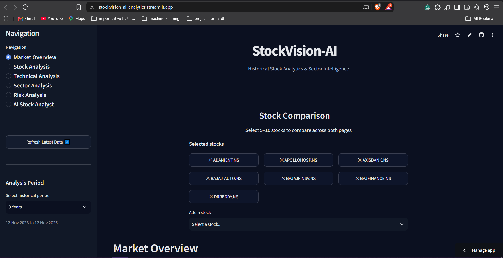

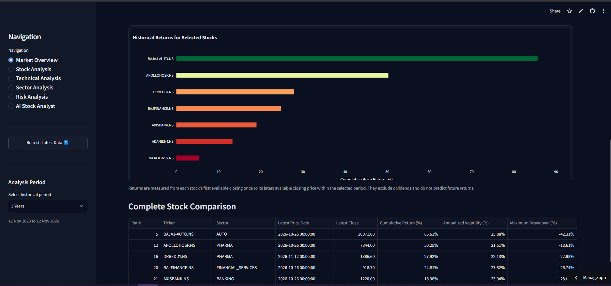

### Stock Analysis

Individual stock performance metrics and historical closing price movements.

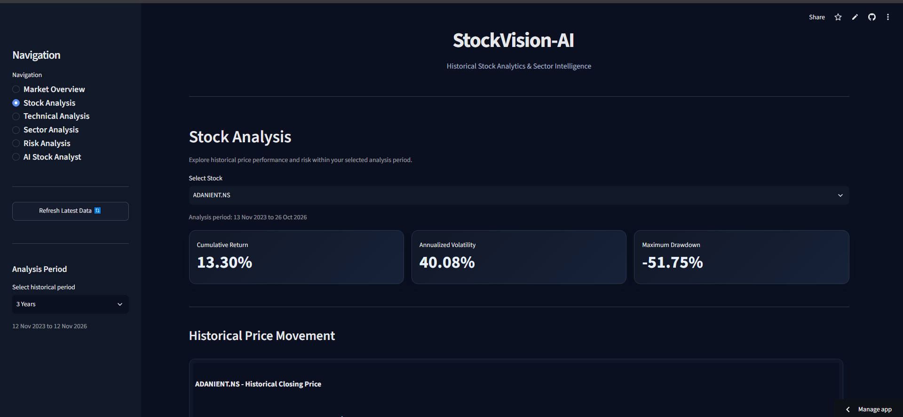

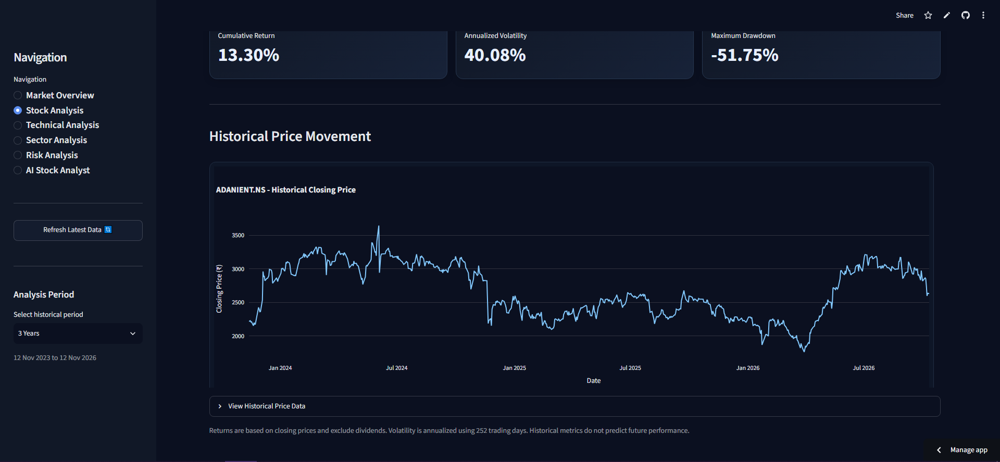

### Technical Analysis

Candlestick visualization with exponential moving averages and trading volume.

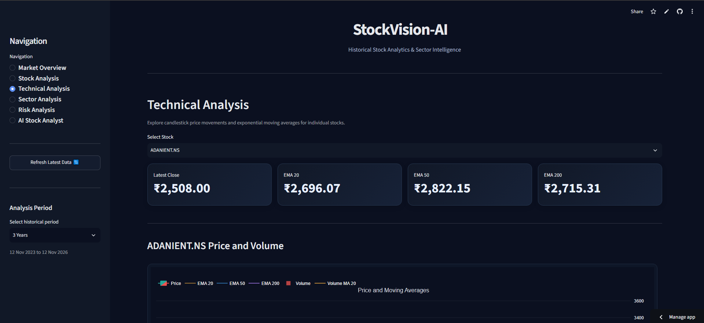

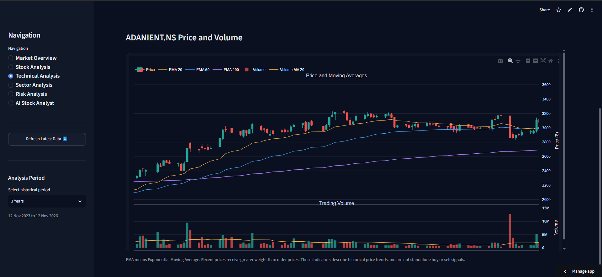

### Sector Analysis

Historical sector performance, sector-level risk comparisons, and stock-level breakdowns.

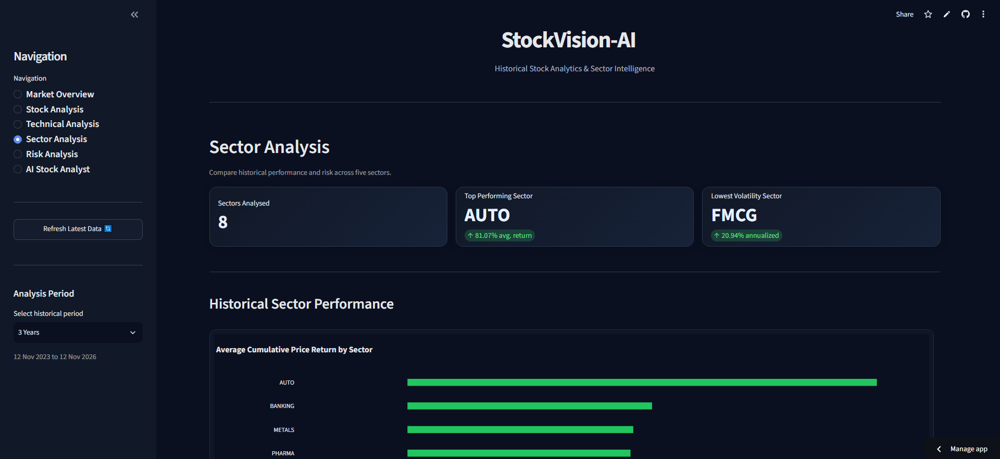

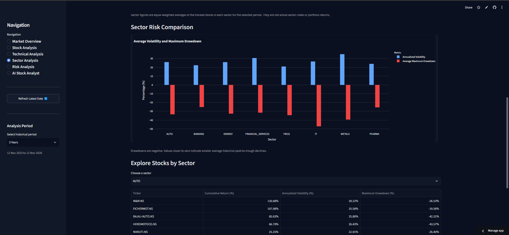

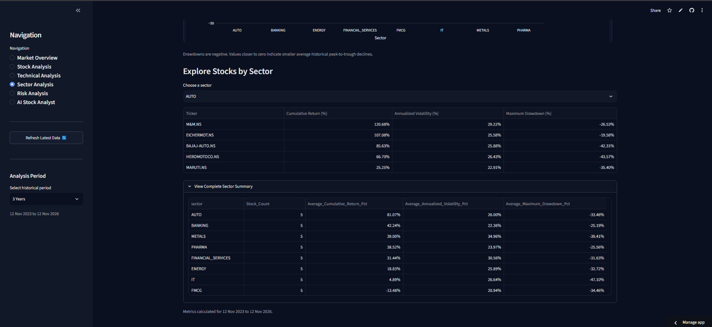

### Risk Analysis

Historical volatility, maximum drawdown, and return-versus-risk comparisons.

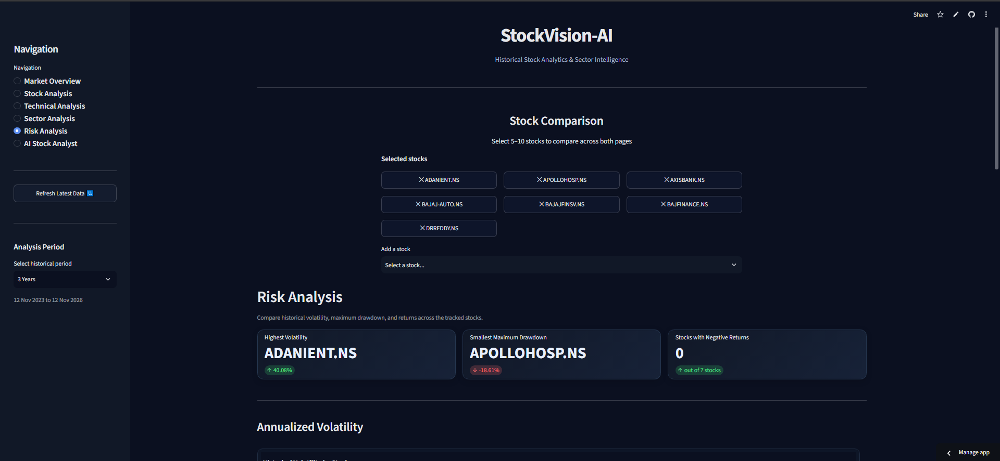

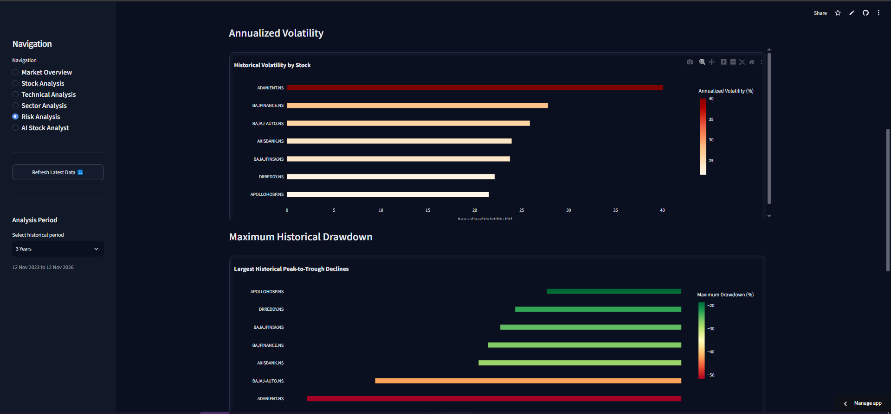

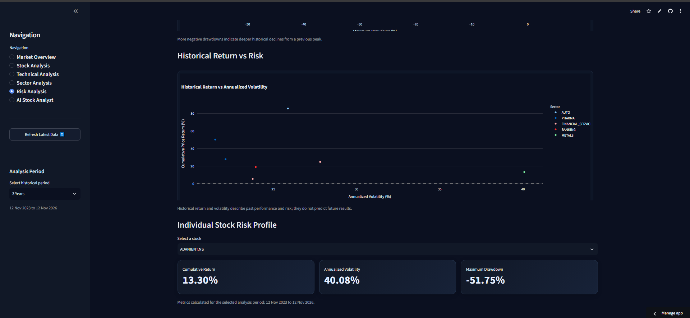

### AI Stock Analyst

Gemini-powered explanations of historical performance, risk factors, and sector comparisons.

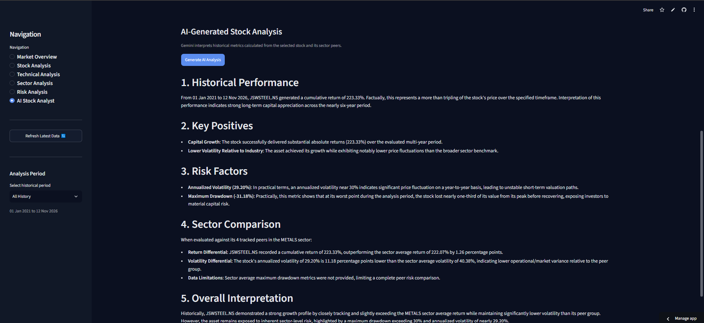
---

## Technology Stack

| Category | Technologies |
|---|---|
| Programming Language | Python |
| Dashboard | Streamlit |
| Data Manipulation | Pandas, NumPy |
| Visualization | Plotly, Matplotlib |
| Machine Learning Experiments | Scikit-learn, XGBoost |
| Database | PostgreSQL |
| Database Hosting | Supabase |
| AI Integration | Google Gemini API |
| Market Data | yfinance |
| Deployment | Streamlit Community Cloud |
| Version Control | Git, GitHub |

---

## System Architecture

The application follows a modular architecture separating dashboard presentation, data access, analytical processing, and AI integration.

```text
                User
                  |
                  v
        Streamlit Dashboard
             app/main.py
                  |
        +---------+---------+
        |         |         |
        v         v         v
     Analysis   Database    AI Layer
      Engine    Connection  Gemini API
        |         |         |
        |         v         |
        |      PostgreSQL   |
        |       Supabase    |
        |         |         |
        +---------+---------+
                  |
                  v
          Interactive Results
```

The historical analytics engine retrieves market data from PostgreSQL and calculates the metrics used throughout the dashboard.

The AI layer receives calculated analytical information and generates contextual explanations using Gemini.

---

## Database

StockVision-AI uses PostgreSQL for persistent storage, hosted through Supabase.

The application currently uses two primary tables:

| Table | Purpose |
|---|---|
| `stock_prices` | Stores historical stock price records. |
| `v2_stock_features` | Stores engineered stock and market features used for analysis. |

The database contains approximately 56,000+ historical feature records across 40 stocks.

Database access is handled through `psycopg`, with configuration loaded from environment variables locally and Streamlit Secrets in the deployed application.

---

## Project Structure

```text
StockVision-AI/
│
├── app/
│   ├── assets/
│   └── main.py
│
├── data/
│   ├── raw/
│   ├── raw_v2/
│   └── processed/
│
├── notebooks/
│
├── src/
│   ├── ai/
│   │   └── gemini_client.py
│   │
│   ├── analysis/
│   │   ├── analytics_engine.py
│   │   ├── classification_analysis.py
│   │   ├── data_analysis.py
│   │   ├── feature_selection.py
│   │   ├── model_evaluation.py
│   │   ├── random_forest_analysis.py
│   │   ├── sector_analysis.py
│   │   ├── vif_analysis.py
│   │   ├── xgboost_analysis.py
│   │   └── ... experimental analysis scripts
│   │
│   ├── data/
│   │   ├── db_connection.py
│   │   ├── stock_collector.py
│   │   ├── data_processor.py
│   │   ├── feature_engineer_v2.py
│   │   ├── migrate_raw_prices_to_postgres.py
│   │   ├── migrate_v2_to_postgres.py
│   │   └── ... data validation and migration utilities
│   │
│   ├── features/
│   │   ├── feature_engineer.py
│   │   └── v2_regression_builder.py
│   │
│   └── models/
│       ├── linear_regression.py
│       ├── logistic_regression.py
│       ├── random_forest.py
│       ├── ridge_regression.py
│       └── ... XGBoost implementations
│
├── .streamlit/
├── requirements.txt
├── .gitignore
└── README.md
```

---

## Getting Started

### Prerequisites

- Python 3.10 or compatible Python environment.
- PostgreSQL database.
- Google Gemini API key.
- Git.

### 1. Clone the repository

```bash
git clone https://github.com/Rishabsawlani/StockVision-AI.git
cd StockVision-AI
```

### 2. Create a virtual environment

Windows:

```powershell
python -m venv venv
.\venv\Scripts\Activate.ps1
```

### 3. Install dependencies

```bash
pip install -r requirements.txt
```

### 4. Configure environment variables

Create a `.env` file in the project root.

Refer to the [Environment Configuration](#environment-configuration) section.

### 5. Run the application

```bash
python -m streamlit run app/main.py
```

The application should open in your browser at the local Streamlit address.

---

## Environment Configuration

The application requires database credentials and a Gemini API key.

Example local `.env` configuration:

```env
# PostgreSQL Configuration
DB_HOST=localhost
DB_PORT=5432
DB_NAME=stockvision_ai
DB_USER=postgres
DB_PASSWORD=your_database_password

# Gemini API
GEMINI_API_KEY=your_gemini_api_key
```

Replace the example values with your actual credentials.

**Security:** Never commit `.env`, database passwords, API keys, or database backup files to GitHub.

For cloud deployment, configure the corresponding variables through Streamlit Community Cloud Secrets.

---

## Deployment

StockVision-AI is deployed using:

- **Application Hosting:** Streamlit Community Cloud
- **Database Hosting:** Supabase PostgreSQL
- **Source Code:** GitHub

The deployed application uses the `master` branch and `app/main.py` as its entry point.

Database credentials and the Gemini API key are configured through Streamlit Secrets.

---

## Development Journey: ML Experimentation

One of the most important parts of this project was exploring whether historical market features could reliably predict short-term stock direction.

The project initially focused on a three-class classification problem:

- **DOWN:** Next-day return below -0.25%.
- **NEUTRAL:** Next-day return between -0.25% and +0.25%.
- **UP:** Next-day return above +0.25%.

### Feature Engineering

The experiments involved engineering technical and statistical features, including:

- Exponential Moving Averages (EMA).
- Moving Average Convergence Divergence (MACD).
- Bollinger Bands.
- Rolling volatility.
- Market and sector-related features.
- Relative performance features.

Feature selection and multicollinearity analysis were also explored using correlation analysis and Variance Inflation Factor (VIF).

### Model Evaluation

The classification experiments exposed a significant challenge: predicting next-day stock direction was difficult, and the models did not consistently outperform a simple majority-class baseline.

The following benchmark results were recorded during the TCS.NS experiment:

| Model | Accuracy | Macro F1 | Weighted F1 |
|---|---:|---:|---:|
| Majority Class Baseline | 45.87% | 0.2096 | 0.2885 |
| XGBoost (Unweighted) | 40.50% | 0.2960 | 0.3542 |
| XGBoost (Weighted) | ~37% | ~0.29 | ~0.34 |

The experiment used a ±0.25% next-day return threshold, with 964 training observations and 242 test observations.

Although the unweighted XGBoost model improved on the baseline's macro F1 score, its accuracy was lower. Class weighting did not provide a convincing improvement either.

These results highlighted the difficulty of extracting reliable predictive signals from the engineered features.

### A Change in Direction

Rather than forcing the predictive models into the final application, the project direction shifted.

The focus moved from attempting to predict future stock movements to building a platform that could provide meaningful analysis of historical market behaviour.

This led to the development of:

- A PostgreSQL-backed historical market data pipeline.
- A modular analytical engine.
- Interactive stock and sector comparisons.
- Historical risk analysis.
- Gemini-powered explanations based on calculated metrics.

The ML experiments remain part of the repository as an important record of the development process.

**The key takeaway:** Not every experiment produces a successful model. Evaluating weak results honestly and changing direction based on evidence is part of building a reliable analytical system.

---

## Limitations

- Historical market analysis does not guarantee future performance.
- Predictive ML experiments did not establish a sufficiently reliable trading signal.
- AI-generated explanations may contain inaccuracies and should be interpreted alongside the underlying data.
- Market data availability and completeness depend on the external data source.
- The application is intended for analytical and educational purposes, not as personalized financial advice.

---

## Future Improvements

Potential areas for further development include:

- Expanding the stock universe and historical data coverage.
- Improving analytical and statistical evaluation methods.
- Adding more market and sector-level indicators.
- Enhancing AI-generated explanations and analytical context.
- Improving automated data refresh and validation workflows.
- Adding automated tests and monitoring for deployed components.

---

## Author

**Rishab Sawlani**

B.Tech Computer Science & AI/ML

GitHub: [@Rishabsawlani](https://github.com/Rishabsawlani)

---

*StockVision-AI is a personal project developed to explore data engineering, financial analytics, machine learning experimentation, interactive visualization, and AI integration.*